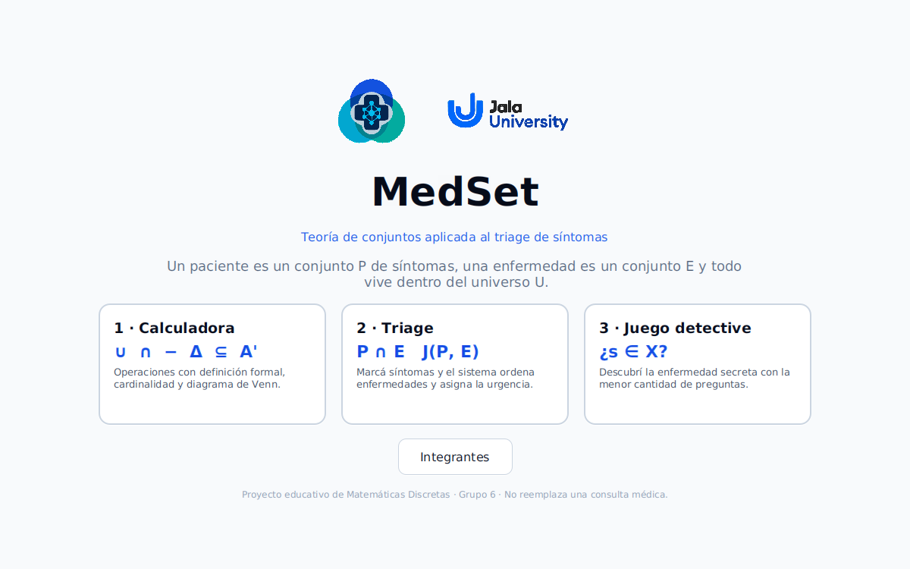
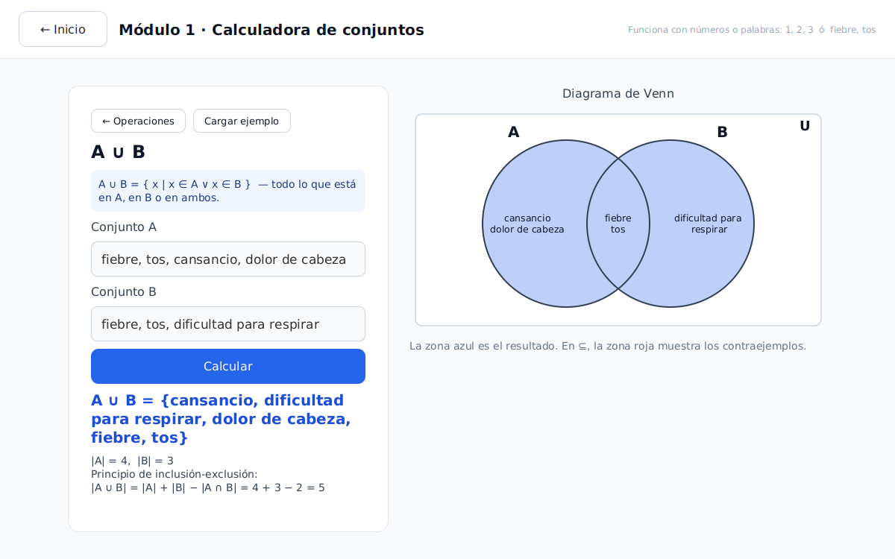
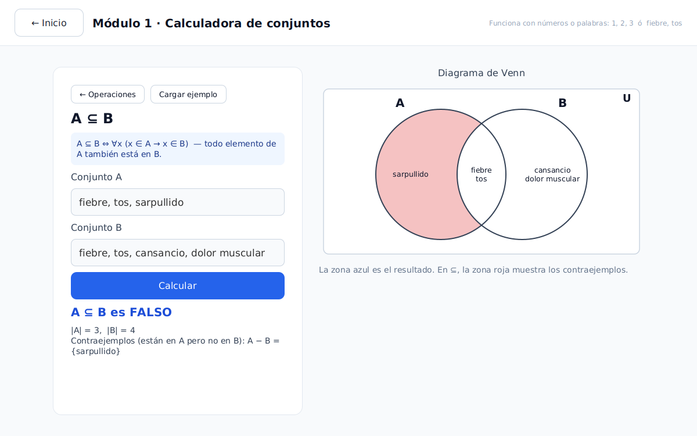
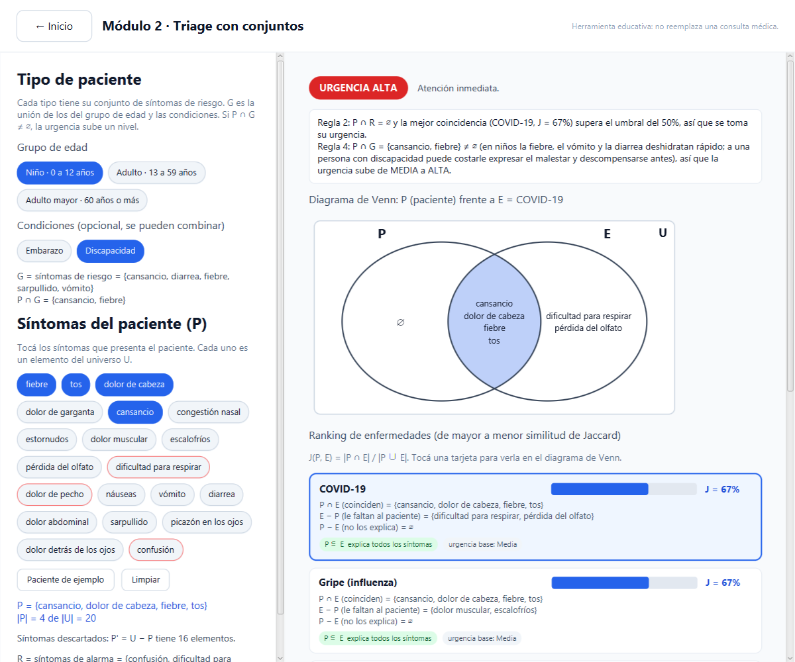
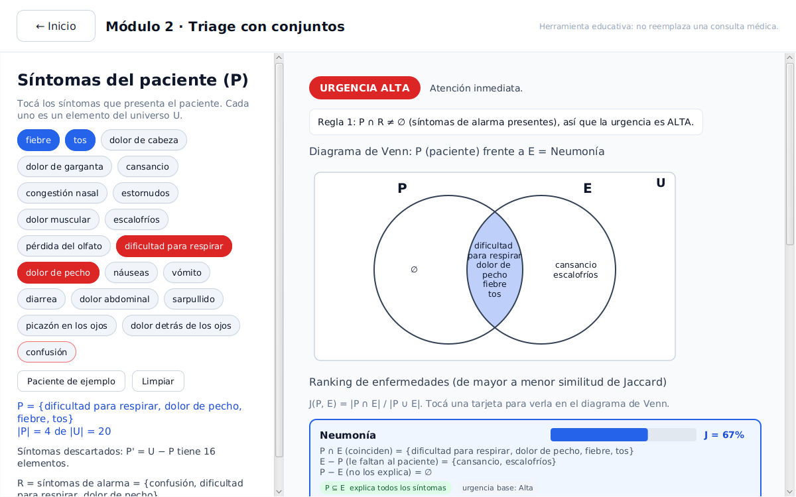
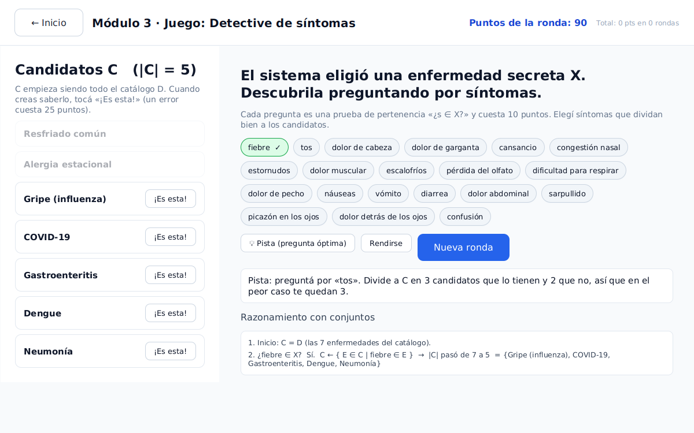

<div align="center">


# MedSet

### Teoría de conjuntos aplicada al triage de síntomas

Proyecto final de **Matemáticas Discretas** · Grupo 6


</div>

---

## Equipo · Grupo 6

- Daniel Tueros Cueva
- Brisa Abigail Alvarez
- Stacul Dario Agustin
- Dayana Lucia Posada Narváez
- Agustin Tomas Gammuto
- Jose David Carranza Angarita

**Profesor:** Rafael Pastor Martínez Vargas

## ¿Qué es MedSet?

MedSet modela un problema real, la clasificación inicial (**triage**) de
pacientes, usando solo teoría de conjuntos:

| Símbolo | Significado |
| :---: | --- |
| **U** | Universo: todos los síntomas del catálogo |
| **P ⊆ U** | Un paciente es el conjunto de sus síntomas |
| **E ⊆ U** | Una enfermedad es el conjunto de sus síntomas típicos |
| **R ⊆ U** | Síntomas de alarma |

Con unión, intersección, diferencia, complemento, inclusión y cardinalidad, el
sistema compara al paciente con cada enfermedad, las ordena por parecido y
decide la urgencia.

> [!NOTE]
> Es una herramienta **educativa**. Los datos clínicos están simplificados y no
> sirven para diagnosticar a nadie.

<div align="center">
  
</div>

## Los tres módulos

### 1 · Calculadora de conjuntos

Calcula operaciones entre dos conjuntos (números o palabras) y muestra la
definición formal, la cardinalidad y un **diagrama de Venn** con el resultado
resaltado.

**Conceptos:** ∪, ∩, −, Δ, ⊆, complemento A', |A|, inclusión-exclusión.

| Unión | Subconjunto |
| :---: | :---: |
|  |  |

### 2 · Triage

Marcás los síntomas del paciente y en vivo se calculan P ∩ E, E − P, P − E y el
índice de Jaccard con cada enfermedad. Con eso se arma un ranking y se asigna la
urgencia con tres reglas lógicas.

**Conceptos:** P ⊆ U, P ∩ R ≠ ∅, ⊆, J(P,E) = |P ∩ E| / |P ∪ E|, relaciones de orden.

| Triage | Urgencia alta |
| :---: | :---: |
|  |  |

### 3 · Juego «Detective de síntomas»

El sistema esconde una enfermedad X. Preguntás «¿s ∈ X?» y el conjunto de
candidatos C se filtra por comprensión. Cada pregunta cuesta puntos; la pista
calcula la pregunta que mejor parte a C.

**Conceptos:** pertenencia, conjuntos por comprensión, particiones, búsqueda binaria.

<div align="center">
  
</div>

## Cómo ejecutarlo

**Requisitos:** JDK 21 o superior (por ejemplo [Temurin](https://adoptium.net/)).
Verificalo con `java -version`. No hace falta instalar Maven ni JavaFX: el
*wrapper* `mvnw` los descarga la primera vez (se necesita internet).

Desde la carpeta del proyecto:

```powershell
# Windows (PowerShell)
.\mvnw.cmd javafx:run
```

```bash
# macOS / Linux
bash ./mvnw javafx:run
```

**Desde IntelliJ IDEA:** abrí la carpeta como proyecto Maven, esperá a que
descargue las dependencias y ejecutá
[`Launcher.java`](src/main/java/com/medset/medsetai/Launcher.java).

## Pruebas

```bash
bash ./mvnw test        # o .\mvnw.cmd test en Windows
```

Hay 18 pruebas JUnit: leyes de De Morgan, no conmutatividad de la diferencia,
principio de inclusión-exclusión, reglas de urgencia y que el juego siempre se
puede resolver.

## Estructura del proyecto

```
src/main/java/com/medset/medsetai/
├── logica/       Operaciones de conjuntos (∪ ∩ − Δ ' ⊆ ∈ |A| Jaccard)
├── modelo/       Catálogo clínico, MotorTriage, JuegoDetective
├── controller/   Controladores de cada pantalla (JavaFX)
└── ui/           Diagrama de Venn
```

Documentación completa:

- [`docs/CONCEPTOS.md`](docs/CONCEPTOS.md): la matemática del proyecto, con ejemplos.
- [`docs/ARQUITECTURA.md`](docs/ARQUITECTURA.md): cómo está organizado el código.

<div align="center">
  <sub>Jala University · Matemáticas Discretas</sub>
</div>
